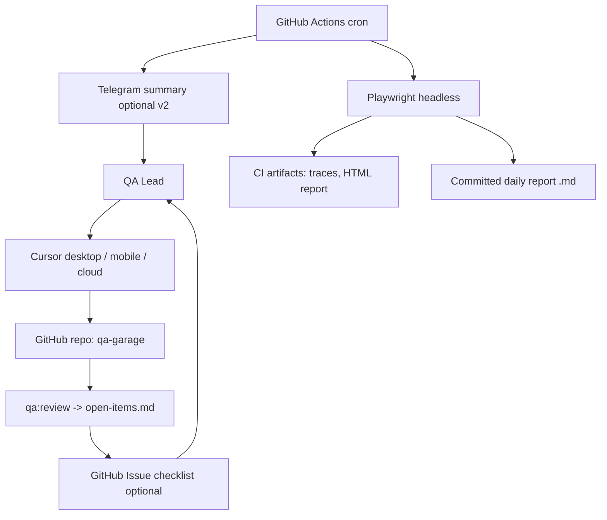

# Infrastructure Roadmap (Design Only)

This document describes the planned infrastructure for operating QA Garage across devices, scheduled runs, notifications, and a lightweight cockpit. Nothing here is implemented yet; it informs future work after the core garage rework is stable.

## Goals

- Sync work between desktop and mobile Cursor without micromanaging artifacts.
- Run scheduled smoke/regression/exploration autonomously with human-readable reports.
- Nudge the QA Lead when blocking decisions or approvals are needed.
- Keep heavy evidence out of git while Markdown reports and context stay reviewable.

## Recommended Stack (v1)

| Concern | Choice | Rationale |
|---------|--------|-----------|
| Sync & system of record | Private GitHub repo | Markdown-first; works on desktop, mobile, and cloud agents; diffs and history for free |
| Scheduled automation | GitHub Actions cron | Headless Playwright, artifact upload, no server to maintain |
| Push notifications | GitHub Issues + mobile app (v1); Telegram bot (v2) | Issues tie to open-items; Telegram for low-friction real-time nudges |
| Report viewing | Committed Markdown in `projects/
/reports/` + Playwright HTML as workflow artifacts | Concise source-of-record in git; heavy HTML behind links |
| Optional dashboard | GitHub Pages from Playwright HTML report | Lightweight cockpit without a custom app |

## Architecture

## Phase 1 — Git + Manual Runs (current)

- All context, plans, scenarios, and tests live in the repo.
- `npm run qa:*` runs locally or in Cursor cloud agents.
- `qa:review` generates `open-items.md`; agent ends turn with ACTION REQUIRED.
- Evidence paths in `.gitignore`; links from Markdown reports.

## Phase 2 — CI Cron

- `.github/workflows/qa-smoke.yml`: daily cron, `QA_PROJECT=
 npm run qa:smoke`, upload Playwright report + traces.
- `.github/workflows/qa-regression.yml`: weekly or on-demand, `@regression` grep.
- Secrets: `TARGET_URL`, test account credentials (GitHub Actions secrets), optional `MOCK_MODE`.
- Fail the workflow on red smoke; post summary to workflow run (and optionally open/update a GitHub Issue).

## Phase 3 — Notifications

- **GitHub Issues:** script or agent opens one issue per project with a checklist mirroring `open-items.md`; close items as human resolves them.
- **Telegram bot:** thin `scripts/notify.ts` posting to a webhook after `qa:review` or failed CI; one-line summary + link to report/issue.
- **Email:** deprioritized unless a send-capable integration is added (current Gmail MCP is read-only).

## Phase 4 — Dashboard & Triage

- Publish Playwright HTML report to GitHub Pages (per project or combined index).
- Optional Cursor cloud agent post-run: triage failures with `ai-bug-triage`, draft bug reports, update `known-issues.md` (human approves filing).

## Separation: Garage vs Project Artifacts

- **In git (durable, light):** `core/`, `.agents/skills/`, scripts, `projects/
/.agents/qa-project-context.md`, strategy/plan/risk/journeys, scenarios, tests, `reports/*.md`, decisions/questions.
- **Outside git (volatile, heavy):** traces, screenshots, videos, large HTML reports → CI artifacts or object storage, linked from Markdown.
- **Future:** extract garage to its own repo (submodule/package) when testing multiple products; keep `core/` separable now.

## Readiness Gate in CI

- Optional job step: `QA_PROJECT=
 npm run qa:review -- --gate` before exploratory or release-gating jobs.
- Override still recorded in `projects/
/decisions.md`.

## Not In Scope (yet)

- Custom web dashboard server.
- Real-time Slack unless team size warrants it.
- Automatic promotion of exploratory findings to regression without human approval.

## Next Implementation Step

When ready to build Phase 2, start with a single-project daily smoke workflow for `postdocs-ai` once blocking questions Q-001–Q-003 are resolved or explicitly overridden.
